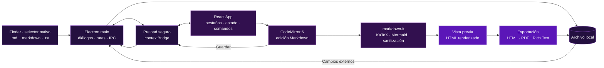

<div align="center">
  
  <h1>MarkDown EV</h1>
  <p><strong>Editor y visor de Markdown nativo, rápido y seguro para macOS.</strong></p>
  <p>Electron · React · TypeScript · Vite · CodeMirror 6</p>
  <p>
    
    
    
    
    
  </p>
</div>

<p align="center">
  <a href="#sobre-markdown-ev">Sobre el proyecto</a> ·
  <a href="#características">Características</a> ·
  <a href="#arquitectura-y-flujo">Arquitectura</a> ·
  <a href="#inicio-rápido">Inicio rápido</a> ·
  <a href="#desarrollo-y-pruebas">Pruebas</a>
</p>

## Sobre MarkDown EV

MarkDown EV es una aplicación de escritorio para abrir, editar y visualizar archivos Markdown directamente desde el sistema de archivos de macOS. No utiliza *vaults* propietarios: trabaja con archivos `.md`, `.markdown`, `.mdown`, `.mkd` y `.txt` mediante el selector nativo, Finder o arrastrar y soltar.

La aplicación combina un editor CodeMirror 6 con una vista previa en tiempo real y un proceso principal de Electron encargado de los diálogos, la lectura/escritura segura, las asociaciones de archivos y la exportación.

## Características

### Edición y previsualización

- Editor Markdown con resaltado sintáctico y modo Vim.
- Vista dividida redimensionable entre editor y previsualización.
- Renderizado de LaTeX mediante KaTeX.
- Diagramas Mermaid con exportación consistente a HTML y PDF.
- Listas de tareas, notas al pie, tablas y resaltado de código.
- Sincronización de desplazamiento entre editor y preview.

### Archivos y productividad

- Apertura desde Finder, selector nativo, arrastrar y soltar o explorador lateral.
- Pestañas múltiples, documentos recientes y breadcrumbs de ruta.
- Guardado, guardado como y protección contra pérdida de cambios.
- Pegado de imágenes con almacenamiento relativo en `./assets/`.
- Exportación a HTML, PDF y texto enriquecido.
- Búsqueda global y paleta de comandos.
- Modo enfoque, temas oscuro/claro y zoom global.

### Seguridad y robustez

- Puente `preload` aislado entre Electron y el renderizador.
- IPC con validación de rutas y raíces permitidas.
- Sanitización del HTML generado y bloqueo de esquemas peligrosos.
- Soporte de archivos UTF-8, UTF-16 y BOM.
- Manejo de documentos modificados antes de cerrar o salir.

## Arquitectura y flujo



### Flujo de apertura y edición

1. Finder, el selector nativo o el arrastre entrega una ruta al proceso principal de Electron.
2. Electron valida la ruta y lee el archivo conservando su codificación compatible.
3. El `preload` expone únicamente las operaciones necesarias mediante `contextBridge`.
4. React crea o actualiza una pestaña y CodeMirror muestra el contenido editable.
5. El parser genera la vista previa, sanitiza el HTML y procesa KaTeX/Mermaid.
6. Guardar escribe de forma controlada en el archivo local; exportar genera el formato solicitado.

## Stack y lenguajes

| Área | Tecnología |
| --- | --- |
| Interfaz | React 19 + TypeScript + TSX |
| Escritorio | Electron 40 |
| Compilación | Vite 8 + electron-builder |
| Editor | CodeMirror 6 |
| Markdown | markdown-it + plugins de tareas y notas al pie |
| Fórmulas | KaTeX |
| Diagramas | Mermaid |
| Estilos | CSS |
| Recursos | SVG, PNG, ICNS |
| Automatización | Node.js scripts + GitHub Actions |

## Inicio rápido

### Requisitos

- macOS, recomendado Apple Silicon.
- Node.js 20 o superior.
- npm.

### Instalación y desarrollo

```bash
git clone https://github.com/MarcOrtiz21/MarkDown-EV.git
cd MarkDown-EV
npm install
npm run dev
```

### Producción

Para generar la aplicación y los instaladores `.dmg` y `.zip`:

```bash
npm run dist
```

El logo se genera desde [scripts/generate-logo.mjs](scripts/generate-logo.mjs). En macOS el script produce automáticamente `public/logo.svg`, `public/favicon.svg`, `build/icon.png` y `build/icon.icns`; en otros sistemas conserva los binarios macOS versionados y permite que el CI compile la aplicación.

## Desarrollo y pruebas

```bash
npm test -- --run
npm run lint
npm run build
```

La suite cubre el parser Markdown y su sanitización, generación de IDs de encabezados, rutas de imágenes, exportación PDF, pestañas y controles principales de la interfaz.

El repositorio incluye GitHub Actions para ejecutar instalación, lint, tests y build en cada push a `main` y en cada pull request.

## Estructura del proyecto

```text
MarkDown-EV/
├── electron/
│   ├── main.ts              # Proceso principal, IPC y ventanas
│   └── preload.ts           # Puente seguro hacia React
├── public/
│   ├── logo.svg             # Logo fuente para la interfaz web
│   └── favicon.svg          # Favicon generado desde el mismo diseño
├── scripts/
│   └── generate-logo.mjs    # SVG, PNG e ICNS reproducibles
├── src/
│   ├── components/          # Editor, preview, toolbar, pestañas y explorador
│   ├── lib/                 # Markdown, imágenes, PDF, configuración y temas
│   └── types/               # Tipos de Electron y plugins
├── build/
│   ├── icon.png             # Icono raster de macOS
│   └── icon.icns            # Icono del bundle de macOS
├── package.json
└── vite.config.ts
```

## Atajos principales

| Acción | Atajo |
| --- | --- |
| Abrir | `⌘O` |
| Guardar | `⌘S` |
| Guardar como | `⌘⇧S` |
| Nueva pestaña | `⌘T` |
| Cerrar pestaña | `⌘W` |
| Exportar PDF | `⌘P` |
| Solo editor | `⌘1` |
| Vista dividida | `⌘2` |
| Solo preview | `⌘3` |
| Paleta de comandos | `⌘⇧P` |

## Licencia

MarkDown EV se distribuye bajo una licencia de uso restringido. Consulta el archivo [LICENSE](LICENSE) para conocer las condiciones de evaluación, modificación y redistribución.

Las dependencias de terceros mantienen sus propias licencias.

## Autor

Marc Ortiz · [GitHub](https://github.com/MarcOrtiz21)
